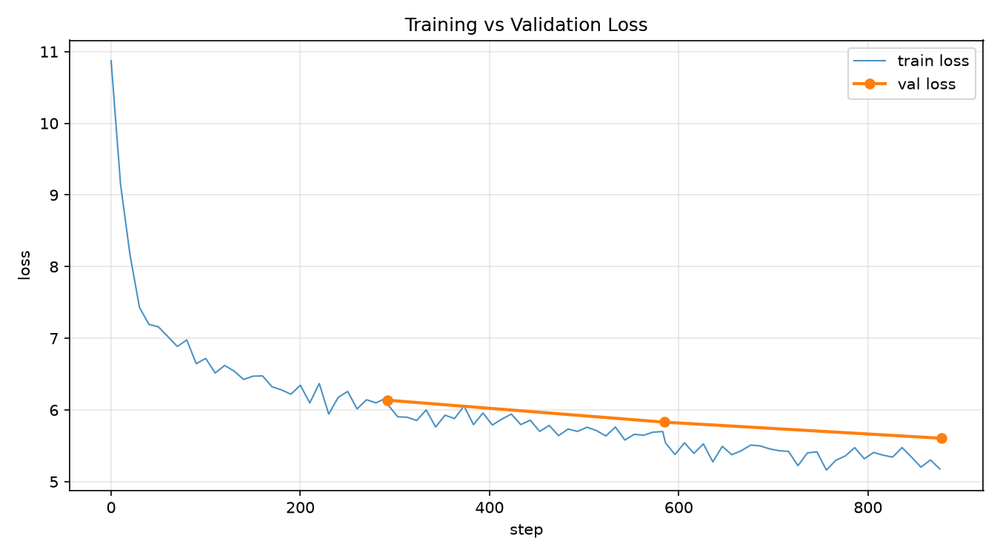

# mini-gpt

A GPT-style decoder-only transformer trained from scratch on wikitext-2, built up piece by piece (data pipeline → embeddings → attention/FFN blocks → training loop → generation).

## Architecture

- Layers: 6
- Heads: 6
- Embedding dim: 384
- FFN hidden dim: 1536 (4x embedding)
- Context length (block_size): 512
- Vocab: 50,257 (GPT-2 BPE tokenizer)
- Dropout: 0.1
- Total params: 30.1M (output projection tied to token embedding weights)
- Block structure: `LN1 -> self-attention (causal, flash/SDPA) -> dropout -> residual -> LN2 -> FFN (GELU) -> dropout -> residual`
- Weight init: GPT-2 style (N(0, 0.02²), residual-writing projections scaled by 1/sqrt(2*n_layer))

## Results

Trained 3 epochs on wikitext-2-raw-v1 (2,403,644 train tokens / 248,461 val tokens):

| Epoch | Val Loss | Perplexity |
|---|---|---|
| 0 | 6.14 | 462.4 |
| 1 | 5.83 | 340.3 |
| 2 | 5.61 | 271.9 |

Initial loss lands at 10.87, matching the theoretical random-guess baseline `ln(50257) ≈ 10.82` — confirms weight init is correct rather than starting from a broken state.



(Only 3 validation points since eval runs once per epoch — the "smooth" val line is 3 points connected, not a dense curve.)

## Hardware / Performance

Benchmarked on an RTX 4070 Laptop GPU (8GB VRAM):
- Peak VRAM at this config: ~6.1 GB / 8.6 GB
- ~237 ms/step, ~293 steps/epoch, ~1.2 min/epoch
- Mixed precision: bf16 autocast (native tensor cores on 40-series, no GradScaler needed)
- The actual memory bottleneck is `batch_size × block_size × vocab_size` (the logits/cross-entropy tensor), not model depth — depth from 4 to 10 layers only moved peak VRAM by ~0.9GB in testing.

## Reproducibility

- Fixed seed: 42 (`torch.manual_seed`, set in `train.py`)
- Optimizer: AdamW (lr=3e-4, weight_decay=0.01), grad_clip=1.0
- Batch size: 16, seq_len (block_size): 512
- All hyperparams in `config.yaml`, loaded via `config.py`

## Files

| File | Purpose |
|---|---|
| `prepare.py` | Downloads wikitext-2, tokenizes with GPT2Tokenizer, caches to `train.bin`/`val.bin` |
| `data.py` | `get_batch()` (random-sampled windows, for quick benchmarks) and `TokenDataset` (non-overlapping windows, for epoch-based training) |
| `model.py` | `GPT` model: embeddings, causal self-attention, FFN, transformer blocks, `generate()` |
| `config.py` / `config.yaml` | All hyperparameters in one place |
| `train.py` | Training loop: logging, checkpointing, validation, resume |
| `generate.py` | Sample text from a trained checkpoint |
| `plot_losses.py` | Plot `training_log.csv` into `loss_curve.png` |

## How to Reproduce

```
pip install -r requirements.txt
pip install torch --index-url https://download.pytorch.org/whl/cu124   # match to your CUDA version

python prepare.py                        # downloads + tokenizes wikitext-2 -> train.bin, val.bin
python train.py --config config.yaml     # trains, writes checkpoints/ + training_log.csv
python plot_losses.py                    # -> loss_curve.png
python generate.py --checkpoint checkpoints/checkpoint_epoch2_final.pt --prompt "The history of"
```

## Checkpointing

- Saves every 200 steps (mid-epoch) and once at the end of each epoch
- Each checkpoint contains model state, optimizer state, epoch, step, and the config used
- Resume: `python train.py --config config.yaml --resume checkpoints/checkpoint_epoch1_step200.pt`
